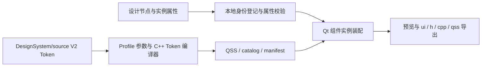

# 设计组件映射指南

组件映射将设计实例的身份、属性和内容翻译为本项目现有 C++ Qt 组件的 API 调用。当前设计事实来自 Figma 文件 `w92BKW1EcutKmTXkwzNHbf`；工程 Token 唯一事实源是 `DesignSystem/source`。历史 Pixso 输入仅存在于只读归档，不参与当前映射、校验或生成。

## 输入与负责人

| 负责人：位置 | 含义与使用方式 |
| --- | --- |
| 当前 Figma 文件、[Figma 组件清单](../../../../Source/ComponentKit/component-definitions/figma-component-inventory.json)及[组件目录源](../../../../Source/ComponentKit/component-definitions/component-catalog-source.json) | 提供可回读的组件集、变体、实例与公共工程身份；它们不定义当前 Token 值或 Profile 名称，缺证据处保持 UNBOUND／UNVERIFIED |
| 本地规则：`mapping/qt-component-map.json` | 登记 Button、IconButton、Checkbox、Input、Select 的开发类、属性、类型、默认值与 API |
| Qt 能力目录：`mapping/qt-native-catalog.json` | 登记 86 个 Qt 类型的职责、开发类、设计名称、属性落点、状态与 Token 绑定 |
| Qt 元对象扫描：`mapping/QtMetaScanner.cpp` | 用 Qt 5.15.2 的 `QMetaObject` 核对属性是否存在、可写及是否为枚举 |
| 本地校验与生成：`mapping/QtMapping.cpp` | `validate / generate / preview / mount` 完成校验、生成、预览和装配 |
| 私有组件：`Source/ComponentKit/runtime` | 接收实例参数，执行绘制、交互和状态转换 |
| 私有 Token 链：`Source/ComponentKit/design-assets` | 编译本地设计参数，生成组件读取的 QSS 和 catalog |

原始响应和本地标准化文件分别说明来源。哈希用于核对已保存输入，远端设计是否更新需要重新采集确认。

## Qt 原生能力如何进入设计与开发

| Qt 类型 | 设计侧表达 | 开发侧表达 | 负责层 |
| --- | --- | --- | --- |
| `QPushButton` 等具体控件 | Figma Component Set、真实节点 ID 与稳定设计属性 | `commonWidget::Z_PushButton` 等 `Z_*` 类 | GenerateComponent |
| `QAbstractButton` 等抽象基类 | 属性与状态继承规则 | C++ 基类合同 | GenerateComponent |
| `QHBoxLayout` 等布局 | Auto Layout、间距、对齐与尺寸模式 | `.ui` 中的 Qt Layout | GenerateLayout |
| Model、Validator、Action | 数据与行为说明 | Controller / Model 接口 | 应用逻辑层 |
| `QPalette`、`QFont`、`QSizePolicy` | Variable、文字样式和结构属性 | Token、QSS、`.ui` | 对应编译层 |

每个属性在能力目录中归入一个落点：`design-variant`、`instance-property`、`design-state`、`token`、`structure`、`runtime-state`、`business-data` 或 `read-only`。这项分类决定设计面板、Token 编译器、`.ui`、组件 API 和业务层各自消费什么数据。

Qt 能力以已安装的 Qt 5.15.2 定义、元对象和实际 SDK 公共接口逐项复核。扫描条目数不等于全 API 覆盖，普通方法、信号与只读结果不得伪装成可写 Designer 属性。

## 当前 Figma 输入边界

现行 Figma 文件为 `w92BKW1EcutKmTXkwzNHbf`；组件集、变体和实例必须使用 `figma-component-inventory.json` 中该文件的真实 ID，并与 `component-traceability-manifest.json` 核对。公共工程身份与映射类型来自 `component-catalog-source.json`；Token 值与 Profile 仅以 `DesignSystem/source` 为准。旧 Pixso 文件及其转换链不再参与当前映射。

当前增量补全规则如下：

1. 保留已有 DSM 组件与变量身份，先审计实际结构及绑定，再针对证据明确的缺口原位修正。
2. 分清 Native、Design System、Composite 与 Engineering Contract；例如 Input、Select 是项目扩展的 QWidget 组合，不能仅凭视觉相似登记成 QLineEdit 或 QComboBox 原生类。
3. Qt 原生属性、公开方法、行为与项目扩展接口分别记录；Figma 状态预览不自动等于 Qt 可写属性或运行验证。
4. 设计变量遵循 v2-source-manifest.json 登记的 Primitive/Profile/Theme/Semantic/Composite/Component/Content 七层及各自物理源；Figma Alias、Scope 和组件绑定须与 V2 源核对，不从外部视觉参考复制未经批准的值。
5. 只有读到现行 Figma 的真实 Component Set、Variant 和必要 Instance ID，才登记相应设计身份；Token ID、旧文件 ID、节点名称或截图不得相互替代。

设计组件命名采用 `ComponentLab/<Name>`，属性使用 `lowerCamelCase`，布尔值固定为 `true/false`，枚举值使用稳定英文值。内容槽固定使用 `LABEL`、`LEADING`、`TRAILING`、`CONTENT`、`CONTROL`、`HINT`、`PREFIX`、`SUFFIX`。

## 组件身份如何对应

| 标识 | 作用 |
| --- | --- |
| 文件标识、节点 ID 与输入哈希 | 定位设计版本与具体实例 |
| Component Set / Key | 匹配组件集及已登记开发类型 |
| 变体属性 | 选择类型、尺寸、材质和初始状态 |
| 实例文本与内容槽 | 将实例覆盖写入文本或图标接口 |
| Qt objectName | 在生成代码和运行对象中定位实例 |

`ComponentLab/Button` 是当前 Figma 文件中的设计身份，开发侧对应 ComponentKit 的 `commonWidget::Z_PushButton`。必须分别核对当前文件的组件集 ID、变体 ID、实例 ID 与 Registry 的设计 ID；相同显示名称或旧文件节点 ID 不足以确认映射。

## Button 映射示例

Button 与其他组件统一使用当前 Figma 文件、`figma-component-map-v2.json` 和组件目录，不维护独立的旧设计平台转换特例。

1. 从保存的节点数据取得组件身份、变体和实例覆盖。
2. 对照 [组件登记表](../../../../docs/examples/MappingWorkbench/mapping/qt-component-map.json) 检查类型与属性值域。
3. 在 `build/cache/button-output` 形成 `button.ui-contract.json`，保留可核对的设计来源。
4. 在工作台载入契约并校验。未知身份、属性或不支持的组合按校验结果处理。
5. 预览调用私有组件；导出动作写出装配文件和来源信息。

命令从项目根目录执行：
```powershell
New-Item -ItemType Directory -Force build/cache/button-output
build/demo/component_mapping_workbench/design_to_code.exe --profile standard-light --mapping-export build/cache/mapping-output
```

## 产物分工

| 文件 | 负责内容 | 开发接入方式 |
| --- | --- | --- |
| `.ui` | 局部装配结构、原生宿主与对象名 | Designer 查看，QUiLoader 加载或 AUTOUIC 编译 |
| `.h` | 装配类的公开声明 | 调用方包含头文件 |
| `.cpp` | 创建已登记组件、应用属性、完成装配 | 链接本项目 ComponentKit |
| `.qss` | 装配容器所需样式 | 配合当前 Profile，组件内部样式继续从 Token 读取 |
| 来源与契约 JSON | 记录身份、实例参数和输入依据 | 比较节点与生成对象，定位未映射项 |

当前能力覆盖组件契约和局部装配。复杂页面的容器转换、工单路由和布局适配有各自的页面工程；本项目的交付包含组件映射所需内容。

## Token 如何工作



设计组件映射处理身份与实例属性。Token 链处理颜色、字体、尺寸及材质。两者在私有组件的公开接口处汇合；导出动作保持现有 Token 求值路径。

## 开发项目如何消费

发布后的 `GeneratedComponentSDK` 提供单一公共入口和统一工厂。调用方无需引用 ComponentLab 演示代码，也不维护组件构造白名单。

```cmake
set(GeneratedComponentSDK_DIR "<SDK目录>/cmake")
find_package(GeneratedComponentSDK 1.0 CONFIG REQUIRED)
target_link_libraries(my_app PRIVATE GeneratedComponentSDK::Components)
```

```cpp
#include <MyDesignSystem/MyDesignSystem.h>

commonWidget::ComponentFactory factory("standard-light");
QWidget *button = factory.create("commonWidget::Z_PushButton", parent);
```

Catalog 的 Widget/Composite、LayoutHelper、Asset 分别验收；只有实际公开类与构造入口通过独立消费测试才能认定可用，不再用历史目录总数声称全部可实例化。

## 完成条件

载入真实案例能够通过契约校验、产生交互预览并导出文件；来源字段可对应保存输入；生成物引用本地组件；`standard-light`、`standard-dark`、`wide-light`、`wide-dark` 四个 Profile、Qt 能力目录、元对象扫描、SDK 外部消费和本项目独立性检查通过。远端设计变化必须重新采集后验证。

## 独立目标库与来源边界

本项目维护现有组件实现及其发布合同。GenerateLayout 可在不改变本 SDK 的情况下，用独立 JSON 和 LibraryProfile 选择目标类；classPrefix 用于整体改名。未实现目标仍标 contract-only/planned，不能登记为本 SDK 已实现组件。设计模型以当前 Registry/Contract/Recipe/Binding 为准，旧 Figma 库存不能反向覆盖合法模型。

Source 中的生成工具只在 build/work 副本输出，映射演示固定样例属于 docs/examples 的维护输入。阶段过程与旧数量表统一归档 docs/archive。
