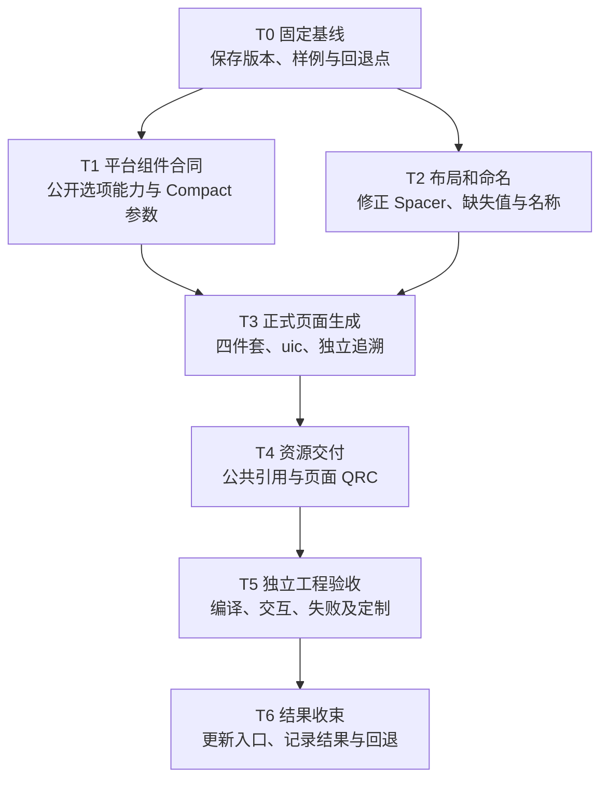

# Gen_layout 最小改造执行计划

日期：2026-10-03。用途：由任务负责人按任务编号分派给执行 Agent。

**状态：2026-10-04，三个 Compact 试点已完成技术验收和用户视觉签核，默认正式入口已切换。本文是本轮唯一执行说明文档。** 最终交付批次为 `build/delivery/compact-release-20261004`；证据在同名 `build/reports/formal-delivery` 目录。以下任务卡保留实施要求，实际完成结果以第 9、11 节为准，不将试点通过扩大为任意设计支持。

## 1. 目标与不可改变的边界

保留现有 HTML + DSL 解析、SDK 组件和可运行 Demo，以最少修改补齐“业务侧使用工具生成文件，自行导入、编译与定制”的链路。不重写生成器，不新建通用中间语言，不扩大到完整组件库或复杂表格开发。

平台部维护工具、组件 SDK 和公共资源工程发布；UCD 维护设计声明、Token 和公共资产内容；业务侧开发者使用工具，导入页面文件，管理页面资源和独立业务代码。平台不替业务逐页生成并长期维护业务界面。

| 已确认约束 | 执行要求 |
| --- | --- |
| 工具没有业务项目写入权限 | 只输出到隔离目录，不自动发现、写入或更新业务仓库 |
| 正式页面使用 uic | .ui 参与业务编译；QUiLoader 可以继续用于工具预览 |
| 当前统一 light-compact | 不扩展四 Profile 切换，不把 Comfortable 数值机械缩放成 Compact |
| 页面四件套 | .ui、.h、.cpp、.qss 必须齐全；无专属样式时 QSS 可仅有说明 |
| 结构和业务分离 | 生成初始化、对象访问和信号接入骨架，不生成数据请求、权限或业务校验 |
| 业务自由度 | 支持公开对象访问、样式覆盖、继承及手改；不保证再次导入保留手改 |
| 设计追溯独立 | 设计 URL、节点 ID、哈希和转换过程保存在交付包外的生成记录 |
| 布局规则 | 明确设计属性映射到 Qt Layout；禁止绝对定位、截图测距填空、虚构尺寸 |
| Spacer 与包装层 | Spacer 只来自显式设计组件；无职责包装层不保留，有职责容器不误删 |
| Token 缺失 | 有明确合法值但无绑定可生成并记录；属性缺失、无效引用或类型冲突不得静默兜底 |
| 资源双轨 | 公共资源引用 SDK；页面静态资源随页面 QRC；动态业务图片由业务处理 |

详细分工及原因继续以[既有 Gen_layout 合同](Qt表格设计声明与原生映射.md)和[Gen_comp 合同](../../DesignToCode_GenerateComponent/docs/Qt表格设计声明与原生映射.md)为依据。本文只增加执行拆解，不复制整套解释。

## 2. 使用现有样例，不重新选择页面

项目根路径缩写：`GL = G:\ComponentLab-Delivery\DesignToCode_GenerateLayout`，`GC = G:\ComponentLab-Delivery\DesignToCode_GenerateComponent`。下文以 GL/GC 开头的路径均以此展开。

| 样例 | 当前用途 | 本轮用途 |
| --- | --- | --- |
| review，节点 19:45 | 输入和复核页，Source/HtmlDsl/generated/review.* | 首个正式页面四件套生成与输入接入 |
| result，节点 21:436 | 结果页，Source/HtmlDsl/generated/result-html.* | 嵌套布局、组件参数、返回与独立业务接入 |
| Case-27-450 | 横向工单，Source/Qt/V2/Case-27-450 | 横纵布局回归及第二种页面结构验收 |
| ReferencePage | Source/Qt/ReferencePage，本地 fixture | 复用 uic 工程结构，不冒充 Pixso 自动生成成果 |

横向样例已保存[设计链接](https://pixso.cn/app/design/4S0Ktm81WnvzuJmZHvRuOg?item-id=27:450)及 experiment.json；其他页面按现有采集记录核对，不猜文件身份，不要求重新提供设计。

2026-10-03 已取得的证据：三个设计页无 node_数字对象名；XML 的 geometry 仅用于根窗口。复核到结果页冒烟通过，横向案例 10 项交互通过、14 个节点几何与保存基线差值为 0；46 项输入/产物/依赖哈希匹配。ReferencePage 的 4 项 Python 静态合同测试通过。

这些结论属于实施前的旧链路快照，不是新交付标准的验收证据。当时样例使用 light-comfortable；后续已获授权修改设计、重新采集并完成 Compact 独立工程验收，见第 9、11 节。

补充事实：GL/Source/HtmlDsl/pipeline/Generate-Pages.ps1 已调用 uic 检查 XML，并丢弃生成头文件。缺少的是“生成页面 .h/.cpp 后，实际编译、链接 SDK 并运行”的证据，不是完全未调用 uic。

## 3. 执行流程框图



T1 和 T2 只在修改文件不重叠时并行，其余按依赖顺序执行。任一任务失败，停在该任务修正，不把不完整产物推给后续任务。无须对每个阶段再次征求范围确认；遇到设计批准值冲突、能力归属变更或必须扩大范围时才报告决策点。

## 4. 最小修改策略

1. 保留原始采集文件和已验证旧 Demo，不覆盖历史证据。新标准产物写到独立 build 输出区域，验证完成后再决定默认入口切换。
2. 复用现有 SceneBuilder、LayoutConverter、组件映射和 SDK。允许为正式交付增加一个小型代码输出模块，不建立第二套设计解析器。
3. 正式输出与预览输出共用已解析页面结果。区别限于交付包装、追溯位置与初始化方式，不各自重新解释设计。
4. 不全面整理目录，不全库重命名，不改无关组件、Token 或业务逻辑。新文件仅限必要的生成模块、测试、页面输出和页面资源。
5. 小任务完成后记录差异和测试；按实际 Git 根提交相关文件，不在 PythonGUI 仓库提交 ComponentLab 文件，不使用全量清理或强制重置。
6. 第 6 节输出路径已在本轮采用。需要调整时只更新本文一处，不另设平行交付约定。

## 5. Agent 任务卡

### T0：固定现状与验收输入

**负责角色：集成/验收 Agent。依赖：无。**

输入：本计划、既有两份合同、GL/Source/Qt/V2、GL/Source/HtmlDsl/generated、GL/build/reports，以及 GC 已发布 SDK。

执行：
- 查明 GL/GC 所属 Git 根、分支、提交及未提交修改。保留用户工作；只为任务相关现状建立可恢复基线，不夹带无关文件。
- 在独立机器记录中固定工具版本、Qt/编译器、SDK 版本与哈希、设计输入、映射、字体和旧 Demo 产物。
- 重放三页的既有测试，明确哪些测试只读取历史报告。核对前轮证据目录是否仍存在，不把旧时间戳改成本次结果。
- 确认 light-compact 批准值来自哪里；设计 Variant 与新 Profile 冲突时逐项列明，不修改原始采集数据。由 UCD 确认必要的设计差异，再进入正式 Compact 验收。

输出：隔离基线证据、回退引用、本文进度表 T0 记录。无新说明文档。

完成条件：现有样例位置明确、旧流程可重放或失败已定位；输入、SDK 和批准尺寸可追溯。真实业务试点项目与现有技术验收样例分开记录，不因已有 Demo 就声称真实业务已接入。

### T1：补齐 SDK 公开选项能力和 Compact 合同

**负责角色：平台组件 Agent。依赖：T0。可与 T2 并行。**

证据入口：GL/Source/HtmlDsl/pipeline/runtime/WidgetRegistry.cpp、GL/Source/HtmlDsl/pipeline/mapping/extensions.json、GC/Source/ComponentKit。

当前缺口：SelectOptionAdapter 位于布局工具内部，通过取出 Select 列表并重设父对象实现效果。正式页面不能依赖这个私有实现；选项规则还限定 light-comfortable。

执行：
- 在 GC 查找现有公开选项能力。优先复用；确实没有时，最小化公开一个可供 uic 使用的类或正式适配类，不重做 Select 控件。
- 该类提供 QWidget 父对象构造方式，必要配置在页面初始化阶段通过公开接口传入；默认实例化不得隐含另一套 Profile。
- 只满足当前样例所需的单选项展示、禁用、文字和尺寸，不增加搜索、多选或异步加载功能。
- 固定 light-compact 对应的真实组件参数、样式及资源；将已确认 Token 缺口交 UCD，不发明参数值。
- 按现有发布工具生成新 SDK，记录版本；保留旧 SDK 基线。向 T3 提供公共类名、头文件、构造方式、设置接口和状态测试结果。

修改范围：GC 的相关公开组件、工厂/Designer 适配、映射及测试；SDK 发布快照。GL 对该公开接口的接线由 T3 统一处理，避免并行修改 WidgetRegistry.cpp。

完成条件：独立最小 uic 页面可编译链接该组件；light-compact 的文字、禁用与尺寸通过。业务无需复制布局工具私有类，不依赖 SDK 私有子控件。

### T2：修正布局、缺失值和工程命名

**负责角色：布局转换 Agent。依赖：T0。可与 T1 并行。**

主要文件：GL/Source/HtmlDsl/pipeline/engines/layout_converter/LayoutConverter.cpp、pipeline/compiler/SceneBuilder.cpp、pipeline/compiler/UiCompiler.cpp 的布局输出部分，以及 mapping/engineering-names.json、mapping/layout-mapping.json。

执行：
- 移除由对齐规则自动创建的 Spacer，改用等价且可验证的 Qt 布局对齐、尺寸策略或 stretch。不得换成固定空白 QWidget、虚构 margin 或绝对定位。
- 显式设计 Spacer 才走组件映射。若暂未实现该映射，遇到它明确报不支持，不擅自生成；不要求改造所有样例以加入 Spacer。
- 保留有视觉、事件或尺寸职责的容器，纯结构层转布局；不以“所有 QWidget 都应消失”为目标。
- 将必要 padding/gap 的缺失与显式 0 分开。若上游规范确有合法默认值，必须有依据和来源记录；不能把缺字段默认为 0 后报告输入完整。
- 保留已确认语义名。补齐小驼峰对象/布局名称、C++ 保留字和重复名检查；冲突使用持久化工程名映射，不再追加设计节点 ID 到公开名称。
- 未绑定 Token 的明确值继续允许，但产出统一诊断数据供 T3 写入独立记录；断裂 Alias 或类型错误按失败处理。

完成条件：旧 Profile 下受影响页面几何无未解释回归；Formal 模式无自动 Spacer、无子控件绝对定位。增加缺字段、显式 0、重复命名和未知布局的测试。Compact 的预期几何另按批准值验收，不能要求与 Comfortable 像素数相同。

交接：将布局输出改动提交后再交 T3。T2 与 T3 不同时编辑 UiCompiler.cpp。

### T3：生成正式四件套，解除设计追溯运行依赖

**负责角色：页面生成 Agent。依赖：T1、T2。**

主要文件：GL/Source/HtmlDsl/pipeline/compiler/UiCompiler.cpp、pipeline/Generate-Pages.ps1、相关生成入口和映射。参考 GL/Source/Qt/ReferencePage 的 CMake、.ui 和骨架，但不直接把本地 fixture 当设计生成结果。

执行：
- 在现有解析结果上增加明确的正式输出模式，生成 form/PageName.ui、include/PageName.h、src/PageName.cpp、view/res/qss/PageName.qss。旧预览入口保持可用，不暗中切换。
- 按实际页面名生成类与文件；ReferencePage 的 final 和仅 Fields 接口不照搬。暴露最终页面对象及布局的语义化、类型明确访问入口，并支持业务继承，不穿透 SDK 私有内部。
- .cpp 只承担 setupUi、公开实例参数设置及接入骨架。复核校验、页面路由等示范业务放在独立测试调用方，不编进通用生成器。
- 页内文字、组件初始状态和内容设置来自既有解析结果，不能为了移除清单而丢参数。信号接入使用公开 Qt 能力，不虚构每个设计图层的业务信号。
- 正式 XML、代码和 QSS 不带设计 ID、URL、来源哈希；以稳定工程名称完成运行绑定。设计信息和未绑定 Token 诊断写到交付包之外的 generation-record.json。
- 原 .components.json 中的运行必需参数优先编译入 XML 或骨架。只有确需运行配置时才输出最小 config 文件，且不得混入追溯字段；不默认保留原整份清单。
- 正式页面不依赖 UiPage、WidgetRegistry 或设计树。消费 T1 的 SDK 公开类；不把私有适配器复制进页面包。
- 使用批准的 light-compact 解析结果。页面 QSS 限定作用域，不复制整套 SDK 样式，不在页面 .cpp 中设置应用全局样式表。
- 校验输出目录边界，禁止配置成业务工程、Source 或 SDK 目录。先在隔离临时输出完成整套检查，再发布文件，失败不留下可被误认成成功的混合包。

完成条件：三个设计页都能自动生成四件套；生成两次运行产物一致。移走日志、原始设计和设计树后，生成页面仍可在独立工程编译初始化。uic 生成头只作为构建中间文件。

### T4：补齐公共引用与页面 QRC 交付

**负责角色：资源适配 Agent。依赖：T3。**

主要入口：现有 mapping/component-mapping.json 的资源映射、正式输出模块和 SDK 资源清单；不要重建公共资产平台。

执行：
- 保留并验证样例中的公共图标引用，检查其实际来自 SDK，不随页面重复打包。
- 对明确页面专属静态资源生成资源文件、独立 QRC 及可移植引用；采用平台批准的命名空间，不能把文档示例前缀当成现有事实。
- 当前设计页无专属图片时，不修改设计页凑覆盖率。使用一份来源与许可明确、标为测试数据的最小资源 fixture 验证导出和构建；不得宣称其来自 Pixso 原设计。
- 缺少公共资源时报依赖缺口；归属不明时报待确认。不下载任意占位图，不静默改为页面资源，不用同名 QRC 路径覆盖 SDK。
- 业务替换资源使用自有路径或公开接口。动态业务图片不编入页面 QRC。采集地址仅写独立日志。

完成条件：图标可显示；专属 QRC 和实际文件成套，加入独立工程后可加载；移走采集缓存仍正常。资源缺失、路径冲突与未知归属均有失败测试，日志在包外。

### T5：在独立调用工程中按新标准验收

**负责角色：独立验收 Agent。依赖：T4。**

主要入口：GL/Source/Validation、GL/Source/Qt/ReferencePage/tests 及既有 V2 测试。只增加必要测试，验证工程放隔离测试位置，不写实际业务仓库。

执行：
- 建立最小业务调用工程，仅引用发布 SDK 和正式四件套，不链接生成器内部模块。用 AUTOUIC/uic 实际编译、链接和运行，不以 XML 检查替代。
- 调用方安装 SDK 样式、页面 QSS 和业务覆盖，连接输入、确认、返回等演示逻辑。验证值传递、禁用不可触发和公开对象访问。
- 运行三页的 light-compact 几何、文字、状态与资源检查；记录目标窗口及缩放条件。几何/功能自动通过与 UCD 视觉签核分别记录，不发明容差。
- 验证继承、局部样式与资源替换；说明业务手改后再次生成必须自行比对，不测试或宣称自动无损合并。
- 执行第 7 节失败用例，检查非零退出码、失败诊断和正式包未发布。不得用手改生成物让测试通过。
- 更新 check_delivery.py 等旧检查，使其验证当前产物和新合同，不仅相信旧 PASS。合法 Gen_comp 跨项目链接使用有限允许范围，不取消全部链接检查。
- 证明只读业务工程在生成前后文件哈希不变；命令不能靠约定俗成而实际接受业务目录作为写入目标。

完成条件：第 7 节所有适用项目有本次证据；未执行、失败、待 UCD 签核分别标明。没有独立编译证据，不宣称正式交付完成。

### T6：更新现有入口并收束交付

**负责角色：集成/验收 Agent。依赖：T5。**

执行：
- 只对现有 GL/README.md、docs/README.md、docs/DesignMapping/Guide.md 和相关合同做必要事实修正：已有验收页、正式/预览区别、Compact 基线、输出路径与操作命令。
- 不重写全部历史文档，不新增报告说明。旧描述若仅适用于预览，明确标注适用范围；保留资源分工的解释文字。
- 在本文进度表回填提交、SDK 版本、命令、报告及未解决项。机器证据集中到既有 build/reports 下，不只保留在系统临时目录。
- 在 T5 通过且设计差异已处理后才更新默认正式交付入口；旧预览仍可明确调用。失败时保留隔离成果和旧入口，不强行切换。

完成条件：业务侧开发者能按一条已验证命令生成，再按现有入口说明自行导入；交付包、SDK、日志和回退版本一一对应。不能将试点通过扩大为所有组件或任意设计支持。

## 6. 文件交付结构

正式输出根为 GL/build/delivery/<批次>，证据根为 GL/build/reports/formal-delivery/<批次>；执行前确认这两处不是业务工程。一个批次内每页独立四件套，公共 SDK 单独依赖。

```text
build/delivery/<批次>/<页面>/
  form/PageName.ui
  include/PageName.h
  src/PageName.cpp
  view/res/qss/PageName.qss
  view/res/PageName.qrc          # 仅有页面静态资源时
  view/res/images/...           # 与 QRC 配套
build/reports/formal-delivery/<批次>/
  <页面>/generation-record.json # 包外追溯及诊断
  tests/                       # 机器结果和截图
```

结构不要求增加页面 README。构建接入方式集中在既有项目入口文档。页面资源可继续细分 icons/images，但仅在实际存在时创建，不生成空目录或占位配置。

## 7. 验收矩阵

| 项目 | 必须观察到的结果 | 责任 |
| --- | --- | --- |
| 四件套与工程名 | 文件齐全，名称稳定且语义化，无节点 ID 公开命名或重复对象名 | T3/T5 |
| 编译与依赖 | uic + C++ 编译链接通过，只依赖正式输出与 SDK | T5 |
| 运行脱离设计 | 移走设计输入、追溯日志、设计树后仍可运行 | T5 |
| 布局 | 水平/垂直正确，无子项绝对定位；无自动 Spacer 或凑位置容器 | T2/T5 |
| Profile | 组件、文字、布局与资源符合批准的 light-compact，不混入旧尺寸 | T1/T5/UCD |
| 输入完整性 | 缺必需属性失败；显式 0 保留；明确未绑 Token 值生成并登记 | T2/T5 |
| 非法引用 | 未知组件、断裂 Alias、错误类型不静默降级或填值 | T3/T5 |
| 资源 | 公共不复制、页面 QRC 成套；缺失和冲突可诊断，无临时 URL | T4/T5 |
| 业务自由度 | 类型明确的对象访问、信号接入、继承和局部覆盖可用 | T3/T5 |
| 写入边界 | 非法输出目录被拒绝；业务工程文件前后不变 | T3/T5 |
| 失败原子性 | 单页失败不发布混合正式包；失败不能继续沿用旧 PASS | T3/T5 |
| 可重复与回退 | 同源两次生成一致；受控 Token 变化与恢复有预期效果 | T5 |

不能用最终 QSS 中存在字面值判断 Token 失效：最终 QSS 本来就应是解析后的值。检查重点是生成来源、引用解析和受控变化是否到达预期消费端。

业务手改自由不代表平台源文件随意修改。生成器原始输出与业务定制副本分开验证，不把业务修补结果当作生成器成功证据。

## 8. 回退与任务分派规则

- T0 记录实际 Git 基线与 SDK 快照。各任务提交仅包含自身范围；无仓库时保留受控文件清单与哈希，不伪造提交。
- 回退使用对应阶段的反向提交或版本恢复，由执行者先检查后续依赖。不使用 git reset --hard、git clean 或覆盖用户未提交工作。
- 旧采集证据不修改。设计源仅按用户已授权范围修改，本轮限三个验收页面的 Compact 变体切换；保留变更前快照。回退正式入口时恢复匹配的 SDK、映射和输出组合，不只替换 EXE。
- 业务工程的导入与回退由业务侧开发者执行；Agent 只提供准确文件清单和版本，工具不能越权操作。
- Agent 遇到范围外问题，记录在本文进度表“阻断/待决策”列，不趁机修复整个项目。

向执行 Agent 分派时可使用下列模板，不另建任务文档：

> 执行《Gen_layout 最小改造执行计划》的 T__。先读取该任务依赖结果和相关源码，只修改任务列出的责任范围。遵守 uic 正式交付、light-compact、工具不写业务工程、追溯包外保存的约束。执行列明测试并记录真实结果，不以旧报告代替本次测试。不要实现后续任务或新增说明文档。完成后将修改文件、提交/版本、测试证据、剩余问题回填本文进度表。

## 9. 执行进度与未决项

| 任务 | 状态 | 提交/版本与修改文件 | 验证证据 | 阻断/待决策 |
| --- | --- | --- | --- | --- |
| T0 基线 | 完成；设计侧已切换 Compact | GL/GC 无 Git；源码、两侧 SDK 受控 ZIP 与 SHA-256 清单保存在 build/reports/formal-delivery/baseline-20261003 | baseline.json；live-pixso/compact-after.json：3 页、24 个实例、34 个工程节点 | 新采集已用于最终生成；旧技术副本不作为本次验收结果 |
| T1 SDK 合同 | 公开组件和三页技术集成已验证 | GC DesignerWidgets.h/.cpp 新增 designer_widgets::SelectOption；GC/build/sdk 已按原发布脚本重建；GL/build/sdk 未替换 | select-option-green.txt：2 个功能方法通过；实际 uic + MSVC 编译链接及三页运行通过 | 当前类仅用于禁用只读选项，不扩大为通用选择器 |
| T2 布局命名 | 核心规则及当前三页几何已验证 | 必填 padding/gap、显式 0、非法命名门禁；正式布局使用 Qt 对齐，不自动创建 Spacer | compact-geometry-20261003/tests/design-geometry.json：34 节点几何一致；缺字段/命名失败测试通过 | 原设计中承担独立对齐或 Hug 尺寸边界的容器保留；不把全部 QWidget 一概删除 |
| T3 正式生成 | 完成；默认正式入口可用 | Generate.ps1；四件套、全部页面对象访问、包外产物哈希、暂存发布与 uic 检查 | compact-release-20261004/structure-check.json：12 文件、41 个公开对象/布局；真实采集适配通过 | 不是全部异常路径和全部组件类型均已验收 |
| T4 资源交付 | SVG/PNG 图标交付链已验证 | FormalResources.h；既有资源映射增加 ownership；页面资源生成 QRC 和内容文件，公共资源只引用 | generator-resource-tests.txt：19 项通过；rcc 编译、16×16 像素/颜色检查及公开接口替换通过 | 本轮页面资源 fixture 是自制 CC0 图形，不是 Pixso 图片；不承诺任意图像图层映射 |
| T5 独立验收 | 完成；用户视觉签核已取得 | Source/Validation/formal；同一生产发布事务用于故障注入，未增加生产故障开关 | compact-release-20261004：41 项采集/生成合同、5 项 Qt 功能、4 项发布事务、2 项 SDK 功能与 Token 三阶段实验通过；34 节点一致；独立搬迁通过 | Alias 检查只覆盖导出的页面绑定，不扩展为任意设计全覆盖；明确布局值仍保留 Token 缺口风险 |
| T6 收束 | 完成；默认正式、显式预览 | Generate.ps1 默认正式；V2 兼容入口显式传 -Preview；既有 README、Guide 最小修正 | 默认命令生成最终三页；-Preview 隔离生成通过；冲突参数失败测试通过；final-acceptance.json 汇总证据 | 业务导入和定制由业务侧开发者执行，本轮未写入实际业务工程 |

新增设计入口：[DesignTest / page 19:1](https://pixso.cn/app/design/4S0Ktm81WnvzuJmZHvRuOg?file_type=10&icon_type=1&page-id=19%3A1)。先通过本地 Pixso MCP 只读核实文件 key、名称、页面和三个样例，随后按用户明确授权修改这三个样例；证据位于 baseline-20261003/live-pixso。基线初始 remotePageVerified=false 保留为原时间点事实，由后续记录补充，不篡改基线。

基线与测试机器记录统一在 build/reports/formal-delivery 下。原 SDK 已分别归档为 sdk.zip 与 component-sdk-before.zip；源码为 layout-source.zip 和 component-source.zip。恢复前应按 baseline.json 及归档内容比对，仅恢复本轮修改，不覆盖后续用户改动。

历史技术验证输出为 build/delivery/compact-geometry-20261003 下的 review、result、horizontal，各自四件套；result 另含测试图标及 QRC。该批次仅是测试副本，不等同于正式批准页面。最终交付为 compact-release-20261004，输入来自设计侧修改后的重新采集，不再通过测试函数改写 Profile。中间候选保留为历史证据，不是推荐导入入口。

2026-10-03 用户决定：“直接修改设计侧页面，交付标准以新Compact规则为准”。这取代了此前“只改本地测试副本、不修改 Pixso”的临时限制。修改范围为 19:45、21:436、27:450 三个验收页面；不修改组件主件、其他页面或公共变量定义。

已将三个页面的 24 个实例替换为同组件族、同状态和同非 Profile 属性的 light-compact 变体。独立读回确认 24/24；实例文字逐项保留。修改前快照为 before-compact-mutation.json；最终读回为 compact-after.json；三张截图为 compact-19-45.png、compact-21-436.png、compact-27-450.png。实例子层 ID 会随变体替换变化，页面工程节点 ID 保留。

模式检查以实际读回为准：页面读回的显式模式为 ComponentLab MVP / Qt Profile 的 light-compact；实例读回为组件层的 light-compact。曾尝试给页面设置其他集合模式，但接口未在读回中保留，不能声称五个集合均已写入。官方接口要求集合对象而非集合 ID；失败尝试与成功记录分别保存，不以调用无异常代替模式生效。

2026-10-04 用户明确签核：“通过，保留上述明确布局值并继续收尾”。批准范围为当前三个 Compact 截图及页面主间距 20px、上/右/下/左边距 24/28/32/36px；不按比例缩放或猜测边距。这些是获准保留的设计值，不是新增 Compact Token。RAW_LAYOUT_VALUE 风险继续保留，由设计侧后续补全语义绑定。组件外框还受内部操作按钮和边距约束，不能只将 catalog 的 height=32 当成整个输入区域高度。

新采集原文和资源在 build/cache/compact-live-20261003，未改写旧输入。最初直接消费新 DSL 时，result 被 MISSING_LAYOUT_METRIC: autoLayoutPaddingLeft 拦下，证明门禁有效；compact-live-20261003 输出仍是不完整历史批次，不能导入。

该缺口已在既有 adapt_v2.cjs 内修复：新增显式采集清单，不再固定读取历史结果页。HTML 计算属性逐字段对照 compact-after.json 的 Pixso 实测值，只在二者一致时补入 DSL；缺证据、冲突、未知根节点与资源缺失均失败。源码不会把默认 0、截图空白或旧 Profile 值当成新设计决策。三页共 34 个节点实测几何差异为 0。

初轮该适配器有 5 项合同测试，生成器有 21 项，合计 26 项通过。后续扩展到 41 项，见第 11 节。生成记录增加 outputSha256；文件变化或混入额外文件时检查失败。初轮未验证的发布记录失败撤回路径，现已补齐生产同实现的故障注入测试，不用早期结果代替最终结果。

2026-10-04 的中间候选 compact-delivery-20261004 使用显式 -Formal 入口；最终 compact-release-20261004 改由默认正式入口生成。每页 4 文件，共 12 文件；公开页面对象和布局分别 7/17/17。原设计没有页面专属图片，不人为加入测试 QRC；QRC 能力继续由明确标注的独立 fixture 验证。

Verify-RelocatedConsumer.ps1 仅向本工具隔离缓存复制页面包和发布 SDK，重新调用 uic、MSVC 和 QtTest。构建文件检查未引用原交付目录、原 SDK 目录或生成器源码；未复制设计输入和追溯日志，也不读取原字体缓存。该验证证明可搬迁运行，不证明字体回退后的视觉一致性。视觉对照另使用显式加载设计字体的同尺寸截图。

设计回退依据为 before-compact-mutation.json 与 compact-preflight.json 的原主件 ID、模式、尺寸和文字。应仅针对上述三个页面执行反向变体切换，并检查切换后的文字及布局，不恢复整份设计文件，不覆盖并行编辑。视觉签核来自用户本轮明确答复，不由设计写入成功或测试 PASS 推定。

资源声明延用 component-mapping.json 的 resourceMappings.entries，不新增运行清单层。公共条目填写 ownership=shared 和既有 :/icons/... 路径；页面条目填写 ownership=page、绝对本地 source、明确 qrcPrefix、文件 alias、provenance 和 license。来源和许可写入包外记录，页面代码仅保留 QRC 路径。正式图片应另外确保交付许可要求，不能以机器检查代替授权。

页面 qrcPrefix 由资源负责人声明，生成器不发明通用平台前缀。本轮 /formal-fixture/result 仅供自制图标测试，不是批准的业务公共命名空间。未知归属、路径冲突、缺失资源均停止生成，不转为下载或其他归属。当前图标消费接口支持 SVG/PNG，动态业务图片仍由业务代码管理。

本轮平台组件改动为 DesignerWidgets.h/.cpp。最终归档比对另发现 MappingWorkbench 的 6 个文件变化，来源未归因于本任务，未覆盖或回退，清单见 platform-source-diff.json。不能据此声称整个 GC 源码仅有两处变化。新 SDK 清单 SHA-256 为 EF0D5F07BA016CA9638A315732EBB5B8E81CFDF558E90F76D2C00A7E00AD0D35；逐文件完整性见 sdk-integrity.json。正式调用工程消费该发布 SDK，旧 Demo 继续消费 GL/build/sdk。

已定位并修复 Qt5 uic 的一项边界：layout item 写 alignment 会生成无效的三参数 addLayout。生成器不再写这种 XML；可表达的对齐编译成公开 setAlignment 调用，不能等价合并的设计容器保留。独立测试明确调用 uic 生成构建中间头，避免多目标 AUTOUIC 路径冲突。失败批次 compact-contract-20261003 不是有效交付，保留为失败证据，不作为业务导入入口。

完整几何对照曾发现结果页 resultActions 从 490px 的 Hug 宽度扩大为父级 536px 分配宽度。已保留原设计容器的独立尺寸职责，最终批次 34 个节点全部一致；未扩大容差、改期望值或手改生成物。compact-resources-20261003 保留该失败记录，compact-geometry-20261003 保留初次修复证据，最终结果见 compact-release-20261004。

生成器对尚无可证明 Token 引用的明确布局数值输出 RAW_LAYOUT_VALUE 诊断。该记录表示“解析链尚未证明绑定”，不能反推设计源中必然没有 Token，也不能以最终数值合法宣称已经 Token 化。

已有 Demo 可运行、文档合同已确认、正式交付已验证是三种不同状态，执行 Agent 必须分别报告。当前 offscreen 测试存在字体目录及 propagateSizeHints 警告，功能通过不等于人工视觉签核通过。

## 10. 正式入口与采集清单

工具链环境沿用 NativeTools.ps1：QT_ROOT、VS_ROOT、CMAKE_EXE、NINJA_ROOT 和 D2C_NODE_MODULES。先通过现有 Qt/V2 构建入口得到 v2_ui_compiler。Generate.ps1 默认正式，-Formal 保留兼容，旧预览须显式 -Preview。正式调用不接受业务目录或任意 OutputDirectory，只写工具自己的 build/delivery；目录联接、非法批次名和已存在输出均拒绝。

采集清单是输入配置，不是业务交付件。字段为 sourceHtml（原始 HTML）、sourceDsl（同版完整 DSL）、expectedRootId、fileKey、resources（url/local 对）、fontFamily、layoutReference。layoutReference 来自独立 Pixso 属性读取，包含 pages[].id、nodes[].id 和 metrics 的 gap/left/top/right/bottom 五个数值。API 明确返回 0 是有效依据，缺字段不是 0。

下面是本次已执行的单页命令，其余两页仅替换页面名和同源清单。调用方明确提供 Compact 映射，不偷偷修改历史映射。

```powershell
pwsh -File Source/HtmlDsl/Generate.ps1 -CaptureManifest build/cache/compact-live-20261003/review/capture.json -MappingDirectory build/cache/compact-live-20261003/mapping -Font build/cache/compact-live-20261003/review/fonts/HarmonyOS_Sans_SC_Regular.ttf -Batch compact-release-20261004 -Page review
```

同一批次同名页不可覆盖。重跑应选择新的批次，并由业务侧开发者决定是否导入/替换自己的文件；工具不会同步修改业务代码。当前清单是本次采集证据，新设计应重新采集同源 HTML、DSL、布局属性和资源，不复用过期缓存地址。

结构检查使用 python -B Source/Validation/check_delivery.py --formal-batch compact-release-20261004。它校验当前文件哈希、四件套组成、XML 和公开访问器，返回 PASS_STRUCTURE；不会代替编译、行为或视觉验收。独立搬迁验证使用 Source/Validation/formal/Verify-RelocatedConsumer.ps1 -Batch compact-release-20261004 -SdkRoot 指定发布目录。

业务导入时添加 form、include、src 和 view/res 中的真实文件，构建系统运行 uic（或配置 AUTOUIC）。业务启动方安装同一 light-compact SDK 样式并读取页面 QSS；行为通过公开 get*() 访问器、信号槽和派生类接入。有页面资源时将配套 QRC 一并编译，不把包外 generation-record.json 添加为运行依赖。

## 11. 最终验收与保留边界

当前已证明：真实设计 Compact 引用、三页双源解析、语义命名、无子项绝对定位或自动 Spacer、四件套实际编译、34 节点几何、公开对象访问和信号、禁用行为、资源 fixture、独立目录导入、当前文件哈希检查。

2026-10-04 最终交付为 build/delivery/compact-release-20261004，由相同真实设计采集和默认正式入口重新生成。三页共 12 个文件与已签核的 compact-validated-20261004 逐字节一致；入口切换不改变已确认布局或 SDK 样式，比较结果保存为 final-acceptance.json。

新增门禁已用反例复现后修复：映射布尔值写成字符串、文字接口传数字、非法或缺失文本色、未知组件族、母版断裂、Alias 目标缺失、引用循环、消费类型错配和字面值类型错配。失败时不发布页面包。数值 0 与缺失值仍严格区分，合法旧输入继续通过。

Alias 校验覆盖当前 pixTreeNodes 中已导出的绑定，沿当前模式追踪 variableMap；支持字符串 ID 和内部 GUID 对象两种实测格式。三页分别检查 63/90/90 处引用，可达变量分别 58/41/41 个，不能简单相加视为唯一变量总数。此检查证明引用完整与类型一致，不证明 SDK 最终值逐项等于设计变量，也不覆盖未导出的组件母版内部绑定。

实际输出中存在 18/24/24 条变量类型提示差异：部分 colorVar 的 resolvedDataType 写为 BOOLEAN，而目标变量定义及颜色消费字段均为 COLOR。以真实变量定义、引用链和消费字段校验，在 generation-record.json 的 variableValidation.warnings 保留差异，不将错误提示强制转换成布尔值。目前字面值仅验证真实样例已覆盖的 FLOAT/COLOR，其他类型明确报不支持，不猜测格式。

最终批次 tests/contract-tests.txt 记录 36 项生成合同和 5 项采集合同通过；tests/page-tests.txt 记录 5 项功能方法加初始化/清理，共 7 项通过。业务公开 getter 可局部覆盖标题颜色，清除后恢复页面 QSS，前后几何不变。relocated/relocation.json 记录只复制交付文件与发布 SDK 的实际独立构建及运行；SDK 哈希已登记。三张同尺寸运行截图重新生成，用户签核及与签核批次的比较独立记录。

写入边界测试发现并修复了一个实际缺陷：Qt5 的 isSymLink/canonicalFilePath 没有可靠识别 Windows NTFS 目录联接。UiCompiler 现在对输出路径各级额外检查 FILE_ATTRIBUTE_REPARSE_POINT。G 盘是 exFAT，测试将相同 EXE 复制到 C 盘 NTFS 临时工具目录验证，不把文件系统不支持联接误写成安全测试通过。只读测试使用真实拒写 ACL，并先证明写入探针失败；生成前后业务标记文件字节与目录内容均不变，结束后恢复 ACL。

发布事务抽取到 FormalPublication.h，生产与测试调用同一实现。tests/publication-tests.txt 的 4 项功能验证覆盖成功、首份记录失败、最终记录失败后撤回整包、目标目录冲突保留既有文件。最终记录失败发生在整包重命名之后，测试确认 published=false、输出目录消失且暂存内容随后清理。它证明受控失败回退，不宣称抵御断电、恶意并发目录替换或所有操作系统故障。

token-roundtrip/token-roundtrip.json 记录完整三阶段实验：只在隔离 sToken 副本修改 --color/highlight/purple-100，沿原有 Alias/Profile 求值、按钮/表单编译器和公开 SDK 资源入口，到正式 ReviewPage 的按钮。实际像素为 #6235F7 → #0C7B63 → #6235F7；始终为 82×32、可用状态不变。源值恢复后全部 generated 目录字节一致，正式源目录哈希未变化。此证明颜色链，不宣称固化在 .ui 的页面尺寸会自动热更新。

旧预览已在隔离缓存重新生成，没有覆盖原 Demo 或采集原文。preview-regression/qt-results.txt 为 15 项通过；横向 preview-horizontal/qt-result.json 为 10 项交互通过、14 节点几何差 0。新失败门禁未破坏这三个旧样例的可运行路径。

默认入口切换已完成：不传模式开关即生成正式四件套；-Preview 才执行旧预览；V2 的 Build.ps1/Generate.ps1 明确转发 -Preview。混用开关、给预览传正式参数、给正式模式传任意输出目录均失败。最终默认三页生成和显式预览生成均实际执行，后者位于 build/cache/preview-release-20261004，不覆盖旧 Demo。

最终证据集中在 compact-release-20261004：structure-check.json、tests、relocated、token-roundtrip、source-revision.json 和 final-acceptance.json。旧预览运行回归仍引用 compact-validated-20261004 中的原始日志，不改时间戳冒充重跑。source-revision.json 固定最终源码/说明和编译器哈希；baseline-diff.json 确认旧采集和生成示例未覆盖；platform-source-diff.json 单列范围外改动。无 Git 仓库，故不虚构提交号。

本轮完成边界是三个既有样例及已测试的失败合同，不是通用任意稿生成器。仍保留：明确布局值尚未证明 Token 绑定、Alias 仅验证导出页面字段、SelectOption 仅禁用只读、QRC 图片能力由独立 fixture 验证、业务导入需开发者手动执行。以上不影响本轮已批准试点，不得删除风险或宣传为全覆盖。

回退时先停止导入最终批次。仅需旧预览可直接使用 -Preview，无须撤销设计或 SDK；需要完整回退时，按 baseline-20261003 的 ZIP/SHA-256 对照恢复本轮相关源码与匹配 SDK，并按设计快照反向切换三个样例。业务定制文件不由工具恢复，后续用户改动不能被归档覆盖。
