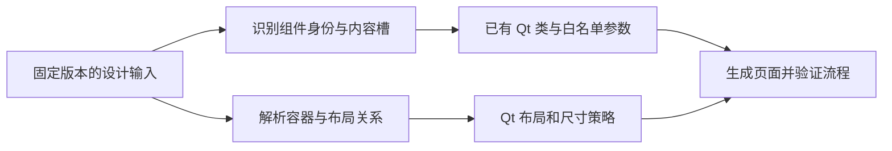

# 设计到布局生成说明

本文解决两个问题：设计中的实例如何使用已有开发组件；设计中的空间关系如何转成 Qt 布局。参数解析与组件 API 的定义见[生成器与 SDK 协作参考](page-delivery/生成器与SDK协作参考.md)，实施步骤见[布局生成上手指南](../../../tutorial/布局生成上手指南.md)。

## 1. 映射不是照着截图重新画一次

组件映射识别“这是什么组件、选了什么属性”；布局转换识别“它与谁相邻、怎样伸缩和对齐”。颜色、材质和内部尺寸仍由现有组件的 Token 合同提供，而不是每个页面重新生成一套组件样式。



| 标识 | 表示什么 | 用途 |
| --- | --- | --- |
| 文件与源哈希 | 哪份设计输入 | 防止拿不同版本的 DSL、HTML 和截图拼成结果 |
| Component Set / Key | 哪一种设计组件 | 匹配已登记的 Qt 类型 |
| 实例 Node ID | 页面上的哪一个实例 | 追踪生成对象及交互事件 |
| Variable ID / Token 路径 | 哪一个可复用设计决策 | 参数引用；不能拿节点 ID 代替 |
| Qt objectName | 生成页面里的对象名 | 加载后定位；需要与原节点保持对应 |

名称用于阅读，稳定身份用于判断。两个节点都叫 Button，不表示它们可以直接映射为同一开发类；母版和实例也不能混为一项。

## 2. 设计组件应该怎样构建，才便于接入

先确认可复用设计语义和部件，再建立公开属性。设计库的嵌套层级用于组织视觉，开发库的类和内部对象用于实现行为，两者不要求每一层都一一生成 C++ 类。

以 Button 为例，可以在设计端区分外层容器、外观层、内容容器、前图标、文字和后图标。开发端仍可以只有一个 `Z_PushButton`，内部由布局、图标绘制和状态机制完成这些职责。

| 设计属性 | 应表达 | 开发映射原则 |
| --- | --- | --- |
| Variant / 枚举 | 有限类型、尺寸、材质 | 映射到已实现的枚举或受校验值，不任意拼字符串 |
| Text | 文案或可编辑内容槽 | 找到命名槽后应用实例覆盖，例如 LABEL → setText |
| Boolean | 可见、禁用、加载等独立开关 | 分清设置内容可见性和改变交互状态 |
| Instance swap | 替换图标或合法子组件 | 先查资源/组件白名单，不任意复制节点像素 |
| Auto Layout | 关系、对齐、尺寸约束 | 转成 Qt 布局，不写成截图坐标集合 |

只为真实差异建立属性。不要为了设计面板分组建立空值属性，也不要把 Theme、平台分辨率和全部业务状态相乘成巨大 Variant 表。复杂组件优先由稳定基础部件组合。

Checkbox 的指示器、标签与组关系应分开；组的 mixed 来自子项状态。Radio 不复用 mixed。Tree 的展开、选中和勾选，导航的选中项和路由，也应分开定义。这些是扩展规则，不表示项目已经实现完整 Tree/Radio/导航库。

旧方案中 Button / Themes / Content 等拆分仍可作为职责参考；其中的旧字体、`jf/*` Token 和旧尺寸不能自动覆盖当前 sToken 参数。设计提案被批准并映射到现有合同后，才能成为实现依据。

## 3. HTML + DSL 页面解析路线

| 路线 | 输入与工具 | 输出 |
| --- | --- | --- |
| HTML + DSL | `Source/HtmlDsl` 保存 HTML、同源 DSL、双源合并工具和 Qt 编译器 | 正式 `.ui/.h/.cpp/.qss`；旧预览另保留组件清单与设计树 |

HTML 用于计算节点尺寸、顺序和布局；DSL 用于确定组件身份、实例属性、状态和 Token 绑定。二者按稳定 Node ID 合并。组件实例通过映射表引用已导入的 `GeneratedComponentSDK`，本项目不实现组件。

## 4. 独立 V2 怎样识别一个组件

规则入口是 [component-mapping.json](../../../../Source/HtmlDsl/pipeline/mapping/component-mapping.json)、[layout-mapping.json](../../../../Source/HtmlDsl/pipeline/mapping/layout-mapping.json) 和 [extensions.json](../../../../Source/HtmlDsl/pipeline/mapping/extensions.json)。

识别顺序固定为：

1. 用 `mainStateGroup` 找组件集，精确匹配名称与 key；用 `mainComponent` 找母版并核对引用。
2. 读取 `propRefMap.variant`，把已登记属性翻译成允许的参数。
3. 找到母版的命名文字槽，再应用实例 `props` 的内容覆盖。
4. 按 GLYPH 身份解析图标及可访问名称，保留实例节点 ID。
5. 对未知组件、值域、槽位或资源返回明确问题，不能默默改成普通矩形。

| 设计组件 | 当前开发消费端 | 已覆盖范围 |
| --- | --- | --- |
| ComponentLab/Button | `commonWidget::Z_PushButton` | 类型、尺寸、材质、图标内容及 default/disabled/loading |
| ComponentLab/Checkbox | `commonWidget::Z_CheckBox` | checked/mixed、尺寸、材质、禁用 |
| ComponentLab/Input | `commonWidget::Z_InputField` | 类型、内容和已登记校验/外观属性 |
| ComponentLab/SelectOption | 正式 `designer_widgets::SelectOption`；旧预览仍使用私有适配器 | single / disabled 的只读选项，正式使用 light-compact |

SelectOption 不是整个 Select 组件，也不代表多选、搜索、异步加载等完整控件行为已经从设计稿映射。hover、pressed、focus 等瞬时状态由原生事件产生，不用一组静态截图替代状态机。

### 真实例子：结果页“提交”按钮

结果页源节点是 `21:436`，其中按钮实例 `21:450` 归属父容器 `21:473`。组件身份匹配 Button 规则，文字槽覆盖为“提交”，设计初始状态为 disabled。

历史预览的 [result-html.components.json](../../../../Source/HtmlDsl/generated/result-html.components.json) 记录了 `setText("提交")` 和 `setEnabled(false)` 等调用。正式链使用稳定工程名 `submitDisabledButton`，调用编译进 `.cpp`，业务通过 `getSubmitDisabledButton()` 接入。设计 ID 与参数来源仅保存在包外日志，不需要运行时读取 components JSON。

规则中的 `setContentMode`、`setIconStyles` 等名称包含适配操作，不保证头文件存在完全同名函数。标准组件调用由 GenerateComponent SDK 的 `ComponentFactory` 白名单执行；[WidgetRegistry.cpp](../../../../Source/HtmlDsl/pipeline/runtime/WidgetRegistry.cpp) 只接入 SDK 工厂和布局侧私有的 `SelectOptionAdapter`。新增规则 API 必须先进入 GenerateComponent 的组件合同与工厂，不能在布局项目中复制一套字符串分派。

## 5. 布局怎样从设计稿进入 Qt

布局转换消费容器关系，不仅是宽高。外部页面布局决定控件占据的空间，现有组件管理自己的文字、图标和内部间距。两者冲突时必须暴露问题，不能一边改 Token 一边把页面固定尺寸锁死。

| 设计字段或意图 | 当前 Qt 转换 | 注意事项 |
| --- | --- | --- |
| HORIZONTAL / VERTICAL | QHBoxLayout / QVBoxLayout | 支持嵌套，保留既有线性布局行为 |
| GRID | QGridLayout | 需要 row、column、rowSpan、columnSpan；重复格子失败 |
| FORM | QFormLayout | 需要 formRow 与 label/field/spanning 角色 |
| ItemSpacing、四边 Padding | spacing、contentsMargins | 输出 XML 属性，保留来源含义 |
| 主轴 start / center / end | 正式模式使用 Qt 布局对齐 | 禁止自动 Spacer；旧预览的实现不得作为正式规则 |
| 交叉轴对齐 | item 的 Qt::Alignment | 不与子控件自身文本对齐混淆 |
| Fixed | minimumSize / maximumSize | 同时约束上下限，避免仅改初始 geometry |
| Hug / RESIZE_TO_FIT | sizeHint；V2 容器使用 Maximum 策略 | 内容尺寸和字体测量必须可信 |
| 父交叉轴 Fill | Expanding sizePolicy | 不等于主轴 Fill 已全面支持 |
| childNode 顺序 | 按当前数据规则逆序插入 | 是当前输入格式的解释，不是所有 DSL 的通用要求 |
| 实例根覆盖 | 母版、实例、根覆盖逐层合并 | 实例结果不能被母版默认值覆盖回去 |

当前样例把 `height resize=1` 解释为 Hug，这属于当前适配规则。主轴 Fill、自由定位、分布式对齐和 Wrap 仍需额外规则；Grid/Form 只在本规范定义的行列、跨度、角色和测试夹具范围内成立，未被测试的组合不套用“自动布局完成”结论。

正式输入要求 gap 和四边 padding 来源明确。新采集清单还提供 Pixso 实测布局属性，与 HTML 计算值逐字段比对；DSL 导出省略零值时，只能凭该证据补全，不能由浏览器默认值或截图空白猜测。三页当前已验证 34 个工程节点几何一致，结论不扩展到任意设计稿。

工单样例中，列表高度由四行 32px 与三个 10px 间距得到 `4 × 32 + 3 × 10 = 158px`，按钮组按内容保持 490px 宽。它们是该设计样本的值，不是所有列表和按钮组的新全局规范。

### 布局数值有来源，不等于已经有 Token 引用

当前转换器会把部分设计尺寸直接编译进 XML。组件外观使用主组件库的 Token，但页面 spacing/padding 等设计值尚不能据此宣称全部进入了语义或组件 Token。

进一步贯通应先建立“设计 Variable ID → 项目 Token 路径”的稳定对照，再让布局转换消费解析后的参数。尚无身份或业务意义的固定值应保留来源与缺口，不机械地为每个像素建立一个页面 Token。

同一尺寸若由页面 XML 和组件 Token 同时约束，应明确谁负责外部占位、谁负责内部最小值，并测试改变任一来源后的结果。这是下一步接入检查，不能靠单张截图判定已完成。

## 6. 生成文件和运行层怎样分工

本节的 `.components.json`、设计树与 `QUiLoader` 说明适用于历史预览。正式模式交付 `.ui/.h/.cpp/.qss`，由 uic 编译、公开 SDK 和业务侧代码消费；同样的追溯信息转入包外 generation-record.json。正式入口与验收以唯一执行计划为准。

| 产物或模块 | 应承担的职责 | 不应承担 |
| --- | --- | --- |
| `.ui` | Qt 布局、对象树、尺寸策略与宿主 | 全量复制基础组件的内部实现 |
| `.components.json` | 节点到类的对应、已解析实例参数和调用 | 无限制的运行时代码执行 |
| `.qss` | 页面级标题、背景等必要样式 | 覆盖组件库的全部状态合同 |
| `.design-tree.json` | 节点、父子、边界、布局与来源的独立记录 | 用推测填满缺失的原设计字段 |
| WidgetRegistry / UiPage | 注册现有类、加载 XML、应用参数、核对唯一节点绑定 | 设计语义决策 |
| WorkflowWindow | 输入、确认、返回和页面状态 | 在业务层重写布局转换算法 |

[SceneBuilder.cpp](../../../../Source/HtmlDsl/pipeline/compiler/SceneBuilder.cpp) 递归处理 FRAME、INSTANCE、PARAGRAPH；[UiCompiler.cpp](../../../../Source/HtmlDsl/pipeline/compiler/UiCompiler.cpp) 写出静态产物；[UiPage.cpp](../../../../Source/Qt/V2/src/UiPage.cpp) 通过 QUiLoader 加载；[WorkflowWindow.cpp](../../../../Source/Qt/V2/src/WorkflowWindow.cpp) 连接流程。

设计树中的未知字段应保留为空或显式缺失，不能为了报告好看伪造变量绑定。输入哈希可证明本地文件彼此对应，不能证明远端文件仍是最新版本，也不能证明像素结果完全一致。

仪表预留区目前是 XML 容器和挂载接口，检查中使用的 QProgressBar 不等于实际设备仪表。要接入真实仪表还需绘制、单位、范围、刷新率和告警合同。

## 7. HTML、DSL、图片与字体的边界

| 输入 | 适合提供 | 当前限制 |
| --- | --- | --- |
| DSL | 组件身份、实例覆盖、层级和布局属性 | 必须匹配实际格式与母版关系 |
| HTML / 浏览器结果 | 当前页面排布、尺寸、文本测量 | 外观相似不能反推稳定组件身份 |
| 截图 | 视觉对照 | 没有公开 API、语义和尺寸策略 |
| 图标/图片文件 | 实际素材 | 需要用途、来源和资源路径登记 |
| 字体 | 可复现的字形与测量 | 字体回退会改变布局，许可与打包需单独确认 |

HTML 与 DSL 必须来自同一页面版本。合并器以 HTML 的实测布局为准，以 DSL 的身份、变体和文字槽为准；任一 Node ID 缺失、重复或来源哈希不匹配时停止生成。

图标使用显式 GLYPH 映射，例如 `GLYPH / search` 对应 `:/icons/search.svg` 和“搜索”名称。未登记资源返回 `UNMAPPED_RESOURCE`，不临时替换为外观相近的图案。

捕获、测量和 Qt 渲染应使用可对应的字体来源。独立 DesignToCode 的字体资源策略与主组件演示的本机安装字体策略需分别检查，不能只看其中一边已加载字体就认为全部一致。

## 8. 如何增加一个设计组件或页面

1. 固定源文件、页面 Node ID、输入快照和资源；确认不是混合版本。
2. 查询现有类及合同。能复用就映射，缺少行为才增加 API，缺少视觉参数才讨论 Token。
3. 登记组件名称与 key、母版槽位、属性值域、状态及资产映射。设计节点不足时明确标为未映射。
4. 先验证一个实例，再放进容器；核对方向、边距、伸缩、顺序与父子约束。
5. 生成页面和参数，在运行时连接信号。不要把动作与路由写进通用组件转换器。
6. 同时检查输入合同、原生行为、布局几何、资源和截图；使用未参与规则开发的案例再检查推广能力。

新增设计节点不应自动生成一个新 C++ 类。新增 C++ 类也不意味着必须先补造一个完整 Figma Component Set；证据可以先是受限参考，但自动识别只能覆盖已登记并验证的规则。

### 常见问题如何定位

| 现象 | 先查哪里 | 正确处理 |
| --- | --- | --- |
| 组件没被识别 | 组件集 key、名称、母版引用 | 修复身份登记或明确不支持，不靠截图猜 |
| 文案仍是默认值 | 命名槽与实例覆盖顺序 | 核对 LABEL / OPTION_LABEL 等实际槽位 |
| 参数出现在 JSON 却没生效 | 白名单分派和真实 API | 区分声明属性、setter 与适配操作 |
| 元素次序或空白不对 | childNode、对齐 spacer、padding | 按当前源格式与布局规则修复 |
| Qt 与截图字号或换行不同 | 字体、逻辑尺寸、固定约束 | 先测量来源，再调整规则，不随意缩字 |
| 源文件改了但页面不变 | 生成路径、输出哈希、运行 data 目录 | 重新生成对应路线，不手改另一份输出 |

## 9. 当前案例、验证入口与未覆盖项

当前主要两页是 `review`（19:45）和 `result`（21:436），均由 HTML + DSL 路线生成；`Case-27-450` 是独立横向工单实验。它们是业务案例和回归输入，不是生成器的页面分支。通用布局能力以 `layout-mapping.json`、[布局转换器通用化规范](../../../designRules/layout/布局转换器通用化规范.md) 和 `Source/Validation/layout/test_shape_matrix.py` 为准，当前覆盖 Qt5 `QVBoxLayout`、`QHBoxLayout`、`QGridLayout`、`QFormLayout`、纵横嵌套、Grid 行列跨度、Form 角色、固定/Hug/Fill、对齐、间距和内边距；未登记能力仍明确失败。

当前映射规则选择 `light-comfortable`。组件库有四份 Profile 产物，不等于页面转换的全部 Profile 组合都已经验证。SelectOption 的限定范围仍然有效。

从 `DesignToCode` 执行以下命令；最后一项只汇总并检查已有证据：

```powershell
python -B Source/Validation/component/check_mapping.py
pwsh -File Source/Qt/V2/Build.ps1 -Test
pwsh -File Source/Qt/V2/Verify.ps1
python -B Source/Validation/check_delivery.py
```

| 检查层 | 完成条件 |
| --- | --- |
| 输入 | 文件、根节点、母版与资源版本可追踪 |
| 身份和属性 | 无未解释的组件/资源错误，无非法参数调用 |
| 结构和几何 | 对齐、尺寸、顺序、缩放及 XML 参数变更符合预期 |
| 行为 | 输入、确认、返回保值、禁用、setter 更新和生命周期有效 |
| 视觉 | 实际字体与资源可用，截图非空，无未说明的文字或布局差异 |
| 推广范围 | 在独立新案例中验证；当前参与规则开发的页面不算独立测试集 |

现有检查包含缩放、临时 XML spacing 修改和重复构造销毁；这些都不能代替设计人员对视觉差异的判断。文档整理没有重新读取云端设计；各条路线是否重建、哪些测试实际执行，以本次验证说明和机器记录为准。

**完成的判断是已登记组件、布局规则和真实流程可以重复生成并运行，而不是“设计工具中的所有属性都已支持”。** 遇到新输入，先确定缺的是组件身份、参数语义、布局规则还是开发能力，再在对应层补齐。

## 10. 设计数据怎样采集和核对

DSL 在本项目中指描述设计节点的 JSON。MCP 是调用工具的通信协议；本地采集器是客户端，工具返回设计字段。不能把 MCP 协议、工具名称和服务内部设计 API 当作同一层能力。

[capture_mcp.py](../../../../Source/HtmlDsl/pipeline/capture/capture_mcp.py) 依次发送 initialize、initialized 通知、tools/list、tools/call。每一步保存请求和响应原文；收到会话 ID 后沿用。目标工具失败时保留原始响应并停止提取，不用空对象补齐。

| 文件或字段 | 来源与用途 | 不能据此证明 |
| --- | --- | --- |
| `*.request.json` | 本地组装并发送的协议请求 | 请求一定成功 |
| `*.response.body` | 保存的 HTTP / JSON-RPC / SSE 正文字节 | 服务身份或设计文件版本得到独立认证 |
| `*.response-meta.json` | 本机接收时间、长度与 SHA-256 | 服务端修改时间或数字签名 |
| `canonical.raw.json` | 单文本块 DSL 的原文按 UTF-8 写出 | 本地已经替它完成语义映射 |
| `pixTreeNodes` / `pixComponentTreeDslNodes` | 页面节点与组件定义 | 组件 API 一定在开发端存在 |
| `variableMap` / `variableSetMap` / `localStyleMap` | 原始变量和样式依据 | 所有变量都已转换成 Qt Token |
| `verification.json` | 本地响应、提取文本与请求 GUID 的核对结果 | 页面像素相同或设计已批准 |

单文本块设计响应取 `result.content[0].text`；其他工具或多内容块按原始索引保存 `content-*`。采集器提取时保留空白、字段顺序和值，不重排设计数据。它不自动导出图片，图片需要独立来源记录。

在 DesignToCode 根目录，下面第一条只核对已有输入，第二条示范另存新采集。新采集目录必须尚不存在；实际端点、工具参数和设计文件要先确认，禁止用 `-O/-OO` 关闭核对断言。

```powershell
python -B HtmlDsl/pipeline/capture/verify_capture.py HtmlDsl/pipeline/design-inputs/result-page
python -B HtmlDsl/pipeline/capture/capture_mcp.py --endpoint http://127.0.0.1:3667/mcp --tool get_node_dsl --arguments '{"guid":"21:436","simplify":false,"isDetachInstance":false}' --output HtmlDsl/pipeline/design-inputs/result-page-new
```

旧记录中的服务自报 `example-server / 1.0.0`，未完整记录实际端点、宿主形式、文件版本和服务端签名。它们是来源证据缺口，不能通过重新计算本地哈希消除。新采集应另补文件与服务身份依据，不改写旧响应。

`pipeline` 内，capture 负责采集，design-inputs 保存证据，mapping 维护规则，engines 解释组件与布局，compiler 写出静态文件，runtime 接入 SDK 工厂，resources 提供本地资产。这些是处理职责，不需要每个目录再写一份指南。

## 11. 生成、Designer 试改和运行对象的关系

构建期将原始 JSON 转成明确的 XML 和参数；运行期不会再次从截图猜布局。程序先注册字体并安装 Token，再加载同组 `.ui`、`.components.json` 和 `.qss`，核对对象名与设计节点，然后连接业务信号。

V2 首次显示前创建复核页和结果页，切换时复用已有对象，工单值保存在窗口内存。`workflow.json` 指定输入、确认、返回和动作节点；页面内容改变后要同步这些绑定，不能只替换一个 objectName。

| 数据种类 | 编译后的落点 | 运行消费端 |
| --- | --- | --- |
| 普通文案、节点身份 | XML、节点对照表 | QLabel、对象查找和事件绑定 |
| 组件属性、文字覆盖、状态 | `.components.json` 的类与白名单调用 | WidgetRegistry 和已有组件 |
| 布局、尺寸模式、顺序 | `.ui` 的 layout、sizePolicy、min/max | QUiLoader 与 Qt 布局系统 |
| 页面样式 | 限定到页面对象的 QSS | 页面；组件继续读取自己的 Token |
| 原始变量和父子来源 | `.design-tree.json` 及原始 DSL | 对照和后续映射，不自动变成业务状态 |
| 工单值和用户操作 | 运行内存与信号槽 | WorkflowWindow |

正式 generated 目录会被重新生成覆盖。要在 Designer 试改，先复制页面的 UI、参数和 QSS 到独立前缀，保留节点名及绑定一致，再用运行器的 `--result` 指向该前缀。确认可用后把变更回写设计或转换规则，不让临时副本成为第二事实源。

例如从 GenerateLayout 根目录运行 `build/demo/page_examples/V2/d2c_v2.exe --result D:/UiExperiment/result`，会加载该前缀的页面文件，其他公共数据仍从既有 data 读取。Designer 没有对应插件时只能显示自定义控件占位，完整效果须看运行程序。

现有测试把临时 XML 的列表 spacing 从 10 改为 14，断言高度变为 170、对应行局部 y 为 46，并确认正式 XML 的哈希不变。这证明本样例消费 XML 布局；不证明所有布局模式都已支持。

部署文件进入 `build/demo/page_examples/V2/data/html-dsl`。生成目录中的 `result-html.*` 在部署副本中统一为 `result.*`，运行器只消费部署后的静态文件。

## 12. 横向工单案例的可复用经验

[Case-27-450](../../../../Source/Qt/V2/Case-27-450) 是同一文件的独立案例，原画板为 1106×560。HTML 提供浏览器布局，DSL 提供身份与尺寸模式，文件上下文另由服务返回信息核对。它不改变前述两页流程的正式输入。

| 操作或资料 | 入口 |
| --- | --- |
| 直接运行 | [Run.cmd](../../../../Source/Qt/V2/Case-27-450/Run.cmd) |
| 看布局 | [generated/page.ui](../../../../Source/Qt/V2/Case-27-450/generated/page.ui) |
| 接业务动作 | [src/CaseWindow.cpp](../../../../Source/Qt/V2/Case-27-450/src/CaseWindow.cpp) |
| 重建并实际验证 | 在 DesignToCode 执行 `pwsh -File Source/Qt/V2/Case-27-450/Build.ps1 -Verify` |
| 查看当次结果 | `build/reports/Case-27-450/verification.json` |

本例检查 14 个节点的父容器局部几何、6 个按钮与 4 个禁用选项，并在 1306×680 下检查边界。返回与确认仅反馈事件，禁用提交保持不可点击；真实业务提交未实现。

原始 HTML 曾出现重复 `const element_*`、缺少 animation.js 和临时 localhost 资源。修补只作用于测量副本：本地化资产、处理重复声明、去掉该静态样例缺失的脚本。原始字节保留，不能将修补推广为“动画也已支持”。

字体、颜色、边框的像素差异由设计复核。输入哈希、同批输入两次生成的确定性和运行几何分别记录；原始输入保存在 Source，执行结果保存在 build/reports。
