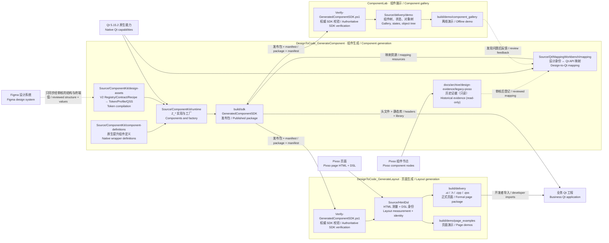
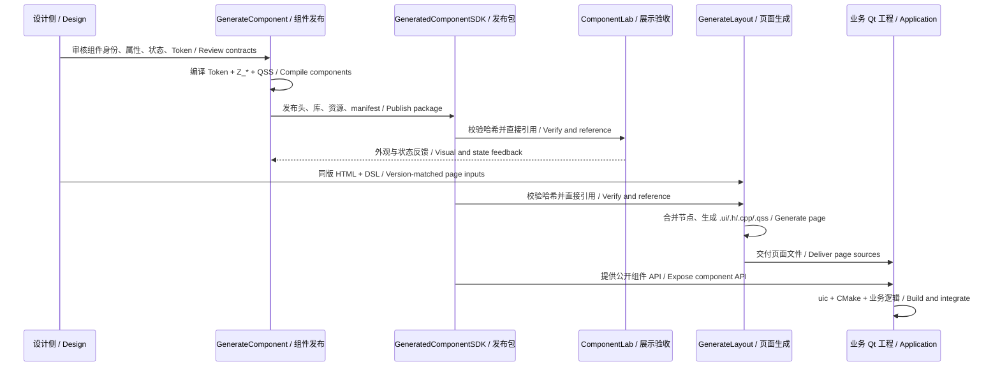

# 三项目总体架构 / Three-project architecture

这张图用于说明三个项目的**职责、目录归属和依赖方向**。`DesignToCode_GenerateComponent` 发布组件 SDK；`ComponentLab` 验收组件外观与状态；`DesignToCode_GenerateLayout` 将设计页面装配为 Qt 页面。后两者是并列消费者，没有相互调用关系。

图形版：[PNG 图片](项目总体架构.png) · [可缩放 SVG](项目总体架构.svg)。下方 Mermaid 是关系的可编辑文本源，图片按同一组节点和依赖绘制。

| 项目 / Project | 负责 / Owns | 输入 / Input | 对外产物 / Output |
| --- | --- | --- | --- |
| `DesignToCode_GenerateComponent`，组件生成 / Component generation | 设计身份与 Qt API 映射、Token 编译、`Z_*` 组件实现和 SDK 发布 | V2 Registry / Contract / Recipe / Binding、经核实的 Figma 值证据、Qt 5.15.2 能力 | `build/sdk`：公开头文件、静态库、Token 和映射资源、CMake 包及哈希清单 |
| `ComponentLab`，组件展示 / Component gallery | 调用已发布组件，展示外观、交互状态、Profile 和对象树 | 已校验的权威 SDK 与演示配置 | `build/demo/component_gallery`、测试报告；不发布 SDK |
| `DesignToCode_GenerateLayout`，页面生成 / Layout generation | 同源 Pixso HTML + DSL 合并、布局与工程命名、SDK 组件装配、页面生成 | 同版 HTML/DSL、布局映射、字体、已校验的权威 SDK | 布局生成工具链；正式页面 `.ui/.h/.cpp/.qss`、可选 QRC 和页面演示 |

依赖方向固定为：`Figma/值证据 → V2 Source → Compiler → SDK → ComponentLab/GenerateLayout/业务工程`。ComponentLab 不回写组件源，GenerateLayout 不生成第二套 SDK，Runtime 不反向成为 Token 或 Figma Variable 的命名来源。任何跨层引用只能指向上游 Contract、Recipe、Generated Manifest 或 SDK 接口；禁止 Source ↔ Runtime、Demo ↔ SDK Source、Figma Variable ↔ 旧 sToken 的反向依赖。

## 1. 项目关系 / Project relationships

实线表示当前代码中存在的输入或发布关系；虚线表示需要人工审核的映射交接或验收反馈。V2 的设计结构权威是 Registry、Contract、Recipe 和 Figma Binding；参考 JSON、旧 sToken 和 Legacy 组件只提供可追溯的终端视觉值，不得反向定义变量命名、组件结构或运行时依赖。既有 Pixso 页面证据仍用于布局生成，但不能回写组件 Token 架构。

运行时公共身份同样遵循 V2 单一身份规则：`ComponentLab/Radio` 和
`ComponentLab/Table` 是设计系统对外身份；`Z_RadioButton`、`Z_TableView`、
`Z_TableWidget`、`Z_DataTable` 只表示 Qt 适配实现。旧的
`RadioButton`、`TableView`、`TableWidget`、`DataTable` 只能作为迁移兼容输入，
不能再作为新的 Figma、Token 或 SDK 公共命名来源。

全工作区唯一权威 SDK 位于 `DesignToCode_GenerateComponent/build/sdk`。ComponentLab 和 GenerateLayout 通过 manifest 与 SHA-256 校验后直接引用该目录，不保存本地 SDK 副本，也不从兄弟项目的 `Source` 编译组件。GenerateLayout 的脚本、编译器和验证程序属于布局生成工具链，不作为 SDK 发布。

三个项目各自维护 `Source`（源码与工具 / source and tools）、`docs`（使用与规则 / guidance and rules）、`build`（可重建产物与报告 / outputs and reports）。具体实现规则以各项目的 [GenerateComponent 说明](../../../DesignToCode_GenerateComponent/README.md)、[ComponentLab 说明](../../../ComponentLab/README.md)、[GenerateLayout 说明](../../../DesignToCode_GenerateLayout/README.md)为准。

仓库根目录 `G:\ComponentLab-Delivery` **不得创建 `build`**。所有 CMake `-B`、测试报告、Demo、SDK 和页面交付产物必须落入其责任项目自己的 `build`：`ComponentLab/build`、`DesignToCode_GenerateComponent/build` 或 `DesignToCode_GenerateLayout/build`。根级 `build` 不代表共享层或聚合层；一旦出现，按错误的可再生中间产物处理，不得从中挑选内容回写源码，也不得让新旧构建链并行。

## 2. 从设计到交付 / Design-to-delivery flow

| 阶段 / Stage | 输入 / Input | 执行与检查 / Action and check | 输出 / Output |
| --- | --- | --- | --- |
| 设计确认 / Design approval | Figma 变量与组件，或 Pixso 节点与实例 | 核对原生 ID、属性、状态、变量绑定；Pixso 证据保留原始响应与哈希 | 经审核的设计合同 / Reviewed design contract |
| 组件编译 / Component compilation | V2 Registry、Contract、Recipe、Binding、Qt 能力目录 | 解析 Token、生成 QSS 与 `Z_*` 源码，编译组件 | `GeneratedComponentSDK` |
| 组件验收 / Component acceptance | 已校验的权威 SDK | 展示外观、状态、对象树，运行交互测试 | ComponentLab 演示与报告 |
| 页面编译 / Page compilation | 同版 HTML + DSL、页面映射、已校验的权威 SDK | 按节点 ID 合并，测量布局，解析组件身份，生成并验证 Qt 页面 | 正式四件套及页面报告 |
| 业务接入 / Application integration | SDK 与正式页面包 | `uic` 编译 `.ui`，CMake 链接 SDK，业务代码接入信号和数据 | 业务 Qt 程序 |

## 3. 关键入口 / Key scripts and source files

以下为**当前主线和验收链的关键入口**。路径缩写均从 `G:\ComponentLab-Delivery` 起算：`GC = DesignToCode_GenerateComponent`，`CL = ComponentLab`，`GL = DesignToCode_GenerateLayout`。脚本所在项目就是维护者。Qt SDK、MSVC、CMake、Python、Node/Playwright 是构建工具，不是第四个项目。

### 组件生成 / GenerateComponent

| 文件 / File | 做什么 / Role | 输入 → 输出 / Input → output |
| --- | --- | --- |
| `GC/docs/archive/design-evidence/legacy-pixso/` | 旧 Pixso 只读历史证据 / Legacy Pixso read-only evidence | 仅作追溯；不再作为当前采集或标准化入口 |
| `GC/Source/Qt/MappingWorkbench/mapping/design/pixso_button.py` | 已登记 Button 变体试点 / Reviewed Button-variant pilot | Canonical 变体 + 明确规则 → 设计映射示例；不代表全组件自动映射 |
| `GC/Source/Qt/MappingWorkbench/mapping/tools/build_qt_catalog.py` | 构建 Qt 能力目录 / Build Qt capability catalog | Qt 类型清单 → `qt-native-catalog.json` |
| `GC/Source/ComponentKit/design-assets/DesignSystem/scripts/v2/compile.py`（入口 `GC/Source/ComponentKit/design-assets/tools/export_tokens.py`） | V2 规范 Token 编译 / Canonical V2 token compiler | `DesignSystem/source/*.json`（四层规范源）→ 上下文解析 → Qt 运行时、CSS、DTCG、Catalog、兼容产物 |
| `GC/Source/ComponentKit/design-assets/DesignSystem/scripts/v2/legacy_migrate.py`、`migrate_contracts.py` | V2 迁移溯源工具 / One-shot migration provenance | 旧 sToken 快照/合同 → V2 源、legacy-map、合同重绑定 |
| `GC/Source/ComponentKit/design-assets/DesignSystem/archive/commerly/` | 旧 Commerly 链与 sToken 导入器归档（只读兼容层） / Frozen legacy chain | 仅作兼容视图与证据；不再写入 |
| `GC/Source/ComponentKit/design-assets/tools/export_tokens.py`、`GC/Source/ComponentKit/design-assets/DesignSystem/scripts/v2/` | 编译 V2 Token / Compile canonical V2 tokens | 四层规范源 + 组件配方 → `tokens_qt.json`、CSS、DTCG 与诊断报告 |
| `GC/Source/ComponentKit/design-assets/tools/checkbox_token_compiler.cpp` | Checkbox 专项过渡编译器 / Transitional Checkbox compiler | Checkbox 合同 → Profile QSS 与 Catalog；不供 Button、Input、Select 使用 |
| `GC/Source/ComponentKit/tools/generate_native_components.py` | 生成薄包装组件 / Generate thin wrappers | `component-definitions/native-components.json` → `Z_* .h/.cpp` 与 QSS |
| `GC/Source/Publish-ComponentSDK.ps1` | 生成、检查、编译并发布 SDK / Build and publish SDK | 组件源码与 Token → `build/sdk` + `manifest/component-sdk.json` |
| `GC/Source/SDKConsumerTest/Build.ps1`、`GC/Source/CheckProject.py` | 独立消费与项目边界检查 / Consumer and boundary checks | 发布 SDK 与源码 → 测试结果 |
| `GC/Source/Qt/MappingWorkbench/Build.ps1` | 构建映射工作台 Demo / Build mapping demo | 映射、SDK/组件源码 → `build/demo/component_mapping_workbench` |
| `GC/Source/ComponentKit/CMakeLists.txt`、`GC/Source/ComponentKit/MyDesignSystem.h` | 定义 SDK 构建目标与单头引用入口 / SDK target and umbrella header | C++ 组件与资源 → 可链接的公开接口 |

### 组件展示 / ComponentLab

| 文件 / File | 做什么 / Role | 输入 → 输出 / Input → output |
| --- | --- | --- |
| `CL/Source/Verify-GeneratedComponentSDK.ps1` | 校验发布者、权限字段和逐文件哈希 / Verify authoritative SDK | 唯一权威 SDK → 校验结果；不复制文件 |
| `CL/Source/delivery/demo/NativeGalleryPages.cpp`、`CL/Source/delivery/demo/ButtonPages.cpp`、`CL/Source/delivery/demo/FormPages.cpp` | 逐组件展示、状态与对象树 / Gallery and object tree | SDK Factory → 演示页面 |
| `CL/Source/delivery/tools/Build.ps1` | 配置、编译、测试、部署 / Build, test, deploy | 权威 SDK + Qt 工具链 → `build/demo/component_gallery` |
| `CL/Source/delivery/tools/CheckProject.py`、`CL/Source/delivery/tools/Verify.ps1` | 目录边界和验证 / Boundary and verification | SDK、源码、测试 → 报告 |
| `CL/Source/delivery/tools/RunPythonTests.py`、`CL/Source/delivery/tools/DeliveryManifest.py` | 运行 Python 合同测试、记录交付清单 / Contract tests and manifest | 演示工程与测试结果 → 交付元数据 |
| `CL/Source/delivery/tools/Package.ps1` | 离线打包 / Offline packaging | 已验证 Demo → 离线交付包 |
| `CL/Source/CMakeLists.txt` | Demo 和测试目标 / Demo and test targets | SDK + 展示源码 → EXE 与测试程序 |

### 页面生成 / GenerateLayout

| 文件 / File | 做什么 / Role | 输入 → 输出 / Input → output |
| --- | --- | --- |
| `GL/Source/Verify-GeneratedComponentSDK.ps1` | 校验发布者、权限字段和逐文件哈希 / Verify authoritative SDK | 唯一权威 SDK → 校验结果；不复制文件 |
| `GL/Source/HtmlDsl/pipeline/capture/capture_mcp.py`、`GL/Source/HtmlDsl/pipeline/capture/verify_capture.py` | 保存并校验 Pixso DSL 原始调用 / Capture and verify DSL | Pixso MCP → 请求、响应、哈希 |
| `GL/Source/HtmlDsl/tools/adapt_v2.cjs` | 测量同源 HTML 并合并 DSL / Measure HTML and merge DSL | HTML + DSL + 资源 → 临时混合设计输入 |
| `GL/Source/HtmlDsl/Generate.ps1` | 正式页面默认入口；`-Preview` 为旧预览 / Formal generator; legacy preview switch | 采集清单、映射、字体、SDK → 页面生成流程 |
| `GL/Source/HtmlDsl/pipeline/Generate-Pages.ps1` | 旧预览逐页编译与 `uic` XML 检查 / Preview compilation and XML check | 页面 JSON → 预览 `.ui/.qss` |
| `GL/Source/HtmlDsl/pipeline/compiler/SceneBuilder.cpp`、`GL/Source/HtmlDsl/pipeline/compiler/UiCompiler.cpp` | 布局树与正式 Qt 文件编译 / Scene and Qt-file compiler | 混合输入 + 映射 → `.ui/.h/.cpp/.qss` |
| `GL/Source/Qt/V2/Build.ps1`、`GL/Source/Qt/V2/CMakeLists.txt` | 构建编译器、运行器及测试 / Build compiler and runner | 生成器源码 + 权威 SDK → `v2_ui_compiler`、页面 Demo |
| `GL/Source/Qt/V2/Verify.ps1` | 复核 V2 生成页面及交互 / Verify V2 page and interaction | 预览输入与程序 → V2 回归报告 |
| `GL/Source/Validation/check_delivery.py`、`GL/Source/Validation/formal/Verify-RelocatedConsumer.ps1` | 页面结构与隔离消费验证 / Package and relocated-consumer checks | 正式包 + SDK → 结构结果与独立工程结果 |

## 4. 当前状态与图示边界 / Current status and diagram limits

1. **SDK 权威源 / SDK authority:** `DesignToCode_GenerateComponent/build/sdk` 是唯一正式 SDK。其内容包括 `include`、`lib`、`resources`、`cmake` 和 `manifest`；两个消费项目只保留校验脚本和依赖配置。
2. **布局工具身份 / Layout tool identity:** GenerateLayout 只保留 HTML + DSL 路线。其编译器与脚本按“布局生成工具链”管理，输出页面源码和演示程序，不输出第二套 SDK。
3. **设计合同边界 / Contract boundary:** Figma/sToken 与 Pixso 证据需要分别校验来源、版本和组件身份。图中的虚线表示人工审核节点，不表示组件映射已经全自动完成。
4. **验收范围 / Acceptance scope:** `check_delivery.py --formal-batch` 的 `PASS_STRUCTURE` 证明当前页面包的结构和文件校验通过；视觉效果、业务逻辑和新页面仍需对应运行验证。

若用于汇报，可按“设计输入 → 组件发布 → 两个并列消费者 → 业务接入”讲解。组件缺失回到 GenerateComponent；页面布局或工程命名错误回到 GenerateLayout；状态展示与可用性问题先由 ComponentLab 复现，再定位 SDK 实现。三种问题各有明确责任项目。
