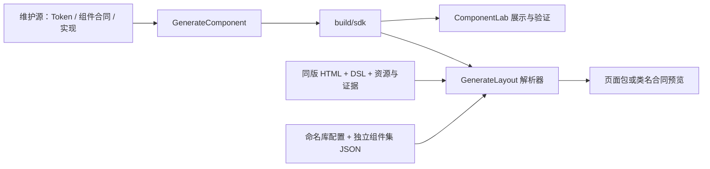

# 三项目总体架构

## 职责与依赖

本工作区将组件生产、组件展示和页面解析分开维护。当前发布的组件 SDK 只有 `DesignToCode_GenerateComponent/build/sdk`；新增目标组件集 JSON 不等于新增已发布 SDK。

| 项目 | 维护输入与实现 | 可再生产物 |
| --- | --- | --- |
| GenerateComponent | Token、Registry、Contract、Recipe、组件实现和生成工具 | build/work、build/sdk、build/resource |
| ComponentLab | 展示页面、控制器、示例数据和验证代码 | build/demo/component_gallery、build/reports |
| GenerateLayout | HTML+DSL 解析、组件映射解析和布局编译器 | build/preview、build/delivery、build/cache |

两个消费项目校验发布清单后直接引用 SDK，不复制 SDK 或生产方私有源码。布局解析器本身目前仍链接 SDK；目标库切换并不表示已去除这一构建依赖。仅修改文档或目标类名合同不需要重新发布组件 SDK。

## Source / docs / build

- `Source`：核心源码、构建工具和必要维护输入。GenerateLayout 的输入夹具、模板、资源和测试分别放在 docs，而不是混在解析器实现中。
- `docs`：现行规范、指导、固定夹具、维护示例、测试与历史档案。不能当临时目录清理。
- `build`：工作副本、生成源码、编译缓存、SDK、页面包和当次机器报告。可删除并重建；不得保存唯一源码、固定输入或唯一验收证据。
- `docs/archive`：历史报告、已替代说明、阶段结果、旧设计证据。历史资料不自动成为当前事实源；需要永久保留的当次报告先冻结归档，再清理 build。
- `待删除-build-20261020`：旧构建隔离区，由用户决定删除。当前流程不得依赖它。

组件生成先由 `Source/PrepareBuild.py` 将维护输入复制到 `build/work`，再在副本中生成与编译。脚本自身属于源码，不能放到可删除的 build。已登记的两份归档审计是只读验证输入，不是 Token 值来源，不因归档治理而改动路径。

## Token 与组件身份

Token 权威源为 `DesignToCode_GenerateComponent/Source/ComponentKit/design-assets/DesignSystem/source`，层次与迁移状态由 `v2-source-manifest.json` 登记：

| 逻辑层 | 维护来源 | 边界 |
| --- | --- | --- |
| Primitive | primitive.json | 原子值 |
| Profile | profile.json | 平台、分辨率和适配参数 |
| Theme | theme.json | 明暗主题和表面环境 |
| Semantic | semantic.json | 跨组件语义角色 |
| Composite | typography/gradient/shadow/blur/motion.json | 复用视觉复合值 |
| Component | component-recipes/*.json | 组件稀疏视觉决策 |
| Content | content/*.json | 术语与国际化文本，不承担视觉和运行时逻辑 |

Registry、Contract、Recipe、Figma Binding 与 Runtime Mapping 分别治理身份/合法组合、结构行为、视觉值、设计绑定和平台映射。生成的 component.json 和展开叶子不作为维护源。运行上下文为 `standard-light/standard-dark/wide-light/wide-dark`；Theme 与 Profile 物理分开，组件 Density 不得靠上下文名称暗中推导。

统一组件集中的公开身份按一对一治理。设计内部 slot/anatomy、变体和 Qt 基类不各自复制公共身份。设计物化、映射登记、实际实现、编译、运行与视觉验收分别记录，不用资产数量推断完成度。

## 多组件库与前缀切换

GenerateLayout 用 `docs/fixtures/layout/mapping/library-profiles.json` 按名称选择目标库。默认 `token-sdk` 不变；`analysis-system` 引用独立组件 JSON。修改其 `classPrefix` 即可整体改变目标 QWidget 类名与自动头文件名，稳定 ID 与设计绑定不变；不是改文件名。

`analysis-system` 当前为 `contract-only/planned`：Qt 基类只用于测量，目标类尚未实现，只允许预览和映射测试。布局与 Spacer 保持 Qt 标准 XML，根页面仍是 QWidget。不能把 uic 通过当作目标类可以链接、实例化或正式交付。

## 执行与验收边界

遵循工作区 AGENTS.md，不自主安装、升级或替换已匹配环境。Python 构建脚本以 3.9 兼容为目标；接口兼容测试不能代替真实 3.9 实机测试。

组件修改按“发布 → 独立消费 → 消费端校验”执行；页面修改按“输入哈希 → 映射 → 结构 → uic/构建 → 行为与视觉”执行。正式页面包含 `.ui/.h/.cpp/.qss/.qrc`，写入 GenerateLayout 的 build/delivery，不写业务仓库。

导航栏 Token `component.navigation-bar.base.state.default.slot.container.height` 的消费契约问题仍按用户决定挂起。不得为了文档更新重启修复或宣称全项目通过。旧测试次数与过程记录见各项目 docs/archive；最新是否通过以对应版本的实际测试为准。
