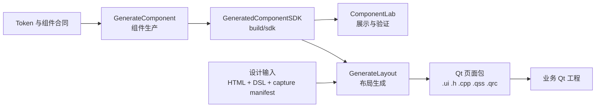

# 三项目总体架构

## 职责

| 项目 | 输入 | 处理 | 输出 |
| --- | --- | --- | --- |
| DesignToCode_GenerateComponent | Token、组件合同、设计绑定、Qt 能力目录 | 编译 Token，生成并构建 `Z_*` 组件，发布 SDK | `build/sdk` |
| ComponentLab | 已发布 SDK、展示配置、测试输入 | 展示组件状态和对象树，执行消费验证 | 展示程序、测试报告 |
| DesignToCode_GenerateLayout | 同一设计版本的 HTML、DSL、资源、采集清单、映射配置 | 合并设计树，识别组件和布局，生成 Qt 页面 | `.ui`、`.h`、`.cpp`、`.qss`、`.qrc` |



## 目录层级

| 目录 | 维护内容 | 产物范围 |
| --- | --- | --- |
| `Source/` | 源码、脚本、编译器和配置 | 修改入口 |
| `docs/` | 规范、教程、固定输入、示例和验证源码 | 长期维护输入 |
| `build/` | 已发布 SDK、稳定工具、固定运行依赖和发布状态 | 受控更新 |
| `output/` | 构建工作区、预览、日志和交付批次 | 可按规则清理 |

根目录 `Source/Workspace.ps1` 只编排三项目。GenerateLayout 通过 `build/sdk` 的公开头文件、静态库、映射资源和 manifest 消费组件。

## Token 与组件身份

GenerateComponent 的 Token 源位于 `Source/ComponentKit/design-assets/DesignSystem/source`。Registry 管理组件身份和合法组合，Contract 管理结构与行为，Recipe 管理组件视觉决策，Binding 保存设计侧绑定，Runtime Mapping 保存 Qt 对应关系。

生成后的 Token、QSS、头文件和静态库进入 SDK。SDK manifest 记录版本、工具链、配置、来源指纹和逐文件哈希。ComponentLab 与 GenerateLayout 在使用前读取并校验该 manifest。

## 构建与验证

工作区入口按以下顺序执行：

```text
doctor → build → verify → package
```

`doctor` 检查已有工具和运行依赖；`build` 先发布组件 SDK，再构建布局工具和 ComponentLab；`verify` 执行跨项目回归；`package` 根据批准的运行依赖清单创建离线包。

结构、uic、C++ 消费、运行行为、视觉核对和新机器离线验收分别记录。某一阶段通过只代表该阶段条件满足。

## 组件库配置

GenerateLayout 通过 `library-profiles.json` 选择目标组件库。`token-sdk` 使用已发布 `Z_*` 组件；`contract-only/planned` 只用于身份和映射测试，不能作为可运行 SDK。布局类和 Spacer 保留 Qt XML 语义，页面根节点使用 QWidget。
